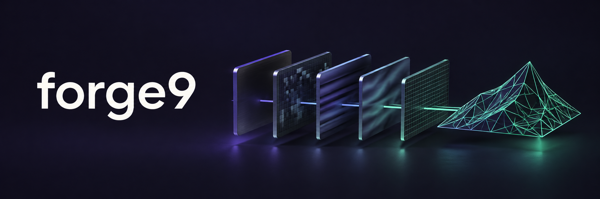

# 

**The most complete open-source RPF9 toolkit.** forge9 is the only tool that can decrypt, inspect, modify and **re-encrypt** RPF9 archives with byte-identical fidelity. It also ships the first open-source PSIN binary-XML decoder, an RDNA2 shader disassembler, a schema database harvester, and a full mod-pack system — 33 commands across 15,000 lines of Rust.

## What makes forge9 different

| Capability | forge9 | Others |
|---|---|---|
| **Full TOC re-encryption** | Byte-identical identity repacks, proven on every archive | Read-only or extract-only |
| **PSIN binary-XML decoder** | DOM tree with typed attributes, struct/enum schemas, XML export | Not decoded |
| **Schema database** | 6,710 struct and 1,132 enum definitions harvested across archives | — |
| **Object graph parser** | 30,683 records, 483 roots, 67 types from the typed object forest | — |
| **RDNA2 disassembler** | Full ISA decode, wave64 analysis, EXEC-uniformity, ray-traversal census | — |
| **Mod packs** | Hash-guarded TOML patches: text, XML, binary ops with `--verify` | — |
| **BCPack textures** | BC1/BC3/BC4/BC5/BC7 decode to DDS/PNG, including array slices | Partial BC1 |
| **Model export** | glTF 2.0 / OBJ with embedded textures from `.ttpf` stores | Partial |
| **Format documentation** | 17 technical documents with KNOWN/UNKNOWN separation | Scattered notes |

[RPF9 format reference](docs/rpf9_format.md) · [All docs](docs/) · [Try without an archive](#try-it-without-an-archive-or-keys) · [Contributing](CONTRIBUTING.md)

## Scope and provenance

forge9 is an independent, interoperability-oriented implementation of the RPF9
container format. It is documentation and code about a file format, nothing more:

- **No copyrighted content.** The repository contains no game code, assets,
  archives, executables, cipher tables or keys, and none may be added. It
  distributes nothing that belongs to any game or its publisher.
- **You supply your own inputs.** The commands that open an archive need
  `tables.bin` and `keys.bin`, which you extract from your own legally obtained
  copy of the software. forge9 ships neither and cannot produce them.
- **Original fixtures only.** Every test builds its bytes in memory (see
  `CONTRIBUTING.md`); no sample is taken from any game.
- **Not affiliated** with or endorsed by any game publisher. "RPF9" and format
  field names are used descriptively to identify the format under study.

The purpose is to understand and interoperate with a file format, not to
reproduce, distribute or enable access to any protected work.

## Install

Check the [Releases page](https://github.com/nineforge0/forge9/releases) for prebuilt binaries. Download the asset for your platform and put it on your `PATH`.

Or build from source with a stable Rust toolchain:

```bash
cargo install --git https://github.com/nineforge0/forge9
```

## Quick start

```bash
# Archive overview
forge9 info archive.rpf
#   magic 9FPR  payload_start 0x1a98  entries 418  key_id 0x08
#   version 0.4  generation 1  trailer 272 bytes

# List entries with format detection
forge9 list archive.rpf --recursive

# Extract everything
forge9 extract archive.rpf -o output/

# Search across nested archives
forge9 search archive.rpf --magic PSIN
forge9 search packs.rpf --drawable          # every exportable model

# PSIN game data: DOM tree as XML
forge9 psin script.rpf 1/10 --xml > config.xml
forge9 psin script.rpf 1 --structs         # struct/enum schemas

# Export a character model with textures
forge9 model packs.rpf 102/33 102/30 119/75 -o character.glb \
  --textures store.ttpf --dedup textures.rpf

# Modify and repack (re-encrypts the TOC)
forge9 repack archive.rpf --patch 6=edited.xml -o modded.rpf --verify
```

### Try it without an archive or keys

```bash
forge9 hash demo_marker
printf '%s\n' '<settings><speed value="1"/></settings>' > original.xml
printf '%s\n' '<settings><speed value="2"/></settings>' > edited.xml
forge9 mod make --path 0 original.xml edited.xml
```

For a graphics diagnostic you can reproduce with synthetic buffers, see the
[geometry smoke test](docs/geometry_check.md#synthetic-smoke-test).

## Command reference

### Archive operations

| Command | What it does |
|---|---|
| `info` | Header fields, entry count, key slot, version |
| `list` | All entries with offset, size, format; `--recursive` for nested RPF9s; `--json` |
| `stats` | Entries per kind, sizes, largest entries; `--top N` |
| `diff` | Compare two archives by inflated payload; exit 1 if different |
| `tree` | Recursive nested-archive tree |
| `search` | Filter by magic, extension, size, content, `--grep-hex`, `--drawable` |
| `catalog` | Full entry catalog with name recovery (dictionary + drawable labels + string candidates) |
| `extract` | Entries to disk with automatic zlib inflation |
| `hexdump` | Raw hex of a single entry |
| `replace` | In-place same-size payload swap |
| `repack` | Rebuild with replaced entries at any size, re-encrypted TOC; `--verify` |

### Format decoders

| Command | Format | Highlights |
|---|---|---|
| `psin` | PSIN / PSO v122 | Binary-XML DOM tree, struct/enum schemas, `--xml` export |
| `object-graph` | Typed object forest | 67 types, root identification; `--census`, `--tree`, `--json` |
| `schema-db` | Cross-archive schema | Harvest all struct/enum defs with dedup and counting |
| `ped-meta` | Character metadata | Part table, texture variation records |
| `awc` | AWC audio | Stream table: codec, channels, sample rate, chunks |
| `shaders` | SGD5 shader DB | Record names, stages, tags, sizes |
| `fssm` | Xbox shader programs | Root layout, used resources |
| `isa` | RDNA2 machine code | Instruction families, wave64 ops, EXEC-uniformity, RT census |
| `disasm` | RDNA2 disassembly | Full operand decode, LLVM-compatible syntax |
| `pipelines` | PS09 pipeline cache | Graphics/compute PSOs, shader slots |
| `bink` | Bink 2 video | Dimensions, frames, rate, duration |
| `resource` | 0DRP paged resource | Kind detection, virtual/physical pointer resolution |
| `model` | Drawables | glTF 2.0 / OBJ with textures; multiple entries merge into one scene |
| `texture` | RDS5 (.ttpf) stores | List, decode BC1–BC7 to DDS/PNG, array slices, `--budget` |
| `bcpack-analyze` | BCPack entropy | Fragment headers, lane symbol stats |

### Modding

| Command | What it does |
|---|---|
| `mod init` | Template `mod.toml` |
| `mod make` | Generate patch ops from an original and edited file |
| `mod verify` | Check every guard and op without writing |
| `mod apply` | Repack with all patches; `--verify` reopens and checks |
| `hash` | Compute joaat hash of a name |
| `harvest` | Name unknown PSIN schema hashes from archive strings |

Published mods: [forge9-mods](https://github.com/nineforge0/forge9-mods). Full spec: [docs/mod_format.md](docs/mod_format.md).

## Detailed usage

<details>
<summary>Archive operations</summary>

```bash
forge9 info archive.rpf
forge9 list archive.rpf --json
forge9 list archive.rpf --recursive
forge9 stats archive.rpf --top 10 --json
forge9 diff old.rpf new.rpf --json
forge9 tree archive.rpf --depth 2
forge9 search archive.rpf --magic ADAT
forge9 extract archive.rpf -o output_dir
forge9 extract archive.rpf --select 0,1,5
forge9 hexdump archive.rpf 0 --limit 256
forge9 repack archive.rpf --patch 6=new.xml -o repacked.rpf --verify
```

</details>

<details>
<summary>Format decoders</summary>

Every decoder takes an archive and an entry index. Use `a/b` to reach an entry inside a nested RPF9
(e.g. `5/3` is entry 3 of the archive stored as entry 5).

```bash
# Audio streams
forge9 awc audio.rpf 12/0

# Shader records and native programs
forge9 shaders shaders.rpf 2
forge9 shaders shaders.rpf 0 --summary
forge9 fssm shaders.rpf 0 --roots
forge9 fssm shaders.rpf 0 --json

# RDNA2 machine code analysis
forge9 isa shaders.rpf 0 --summary
forge9 isa shaders.rpf 0 --opcodes
forge9 isa shaders.rpf 0 --uniformity
forge9 isa shaders.rpf 0 --rt-census
forge9 disasm shaders.rpf 2 --shader 1

# Pipeline cache
forge9 pipelines shaders.rpf 1
forge9 pipelines shaders.rpf 1 --mesh

# PSIN game data
forge9 psin script.rpf 1/10 --xml
forge9 psin script.rpf 1 --structs
forge9 object-graph script.rpf 0/0 --census --tree

# Schema database across archives
forge9 schema-db script.rpf common.rpf

# Models with embedded textures
forge9 model props.rpf 12 -o prop.glb
forge9 model packs.rpf 102/33 102/30 119/75 -o char.glb
forge9 model props.rpf 12 --dump-buffers dump
forge9 check-positions dump/g0.json capture.bin --layout clip --stride 16

# Texture stores
forge9 texture store.ttpf
forge9 texture store.ttpf --budget
forge9 texture store.ttpf --decode 12 -o a.png
forge9 bcpack-analyze store.ttpf --codec bc7

# Character metadata
forge9 ped-meta packs.rpf 143
forge9 ped-meta packs.rpf 5 --normal 7f3231727e17dcc5

# Hash dictionary and name recovery
forge9 hash player_one
forge9 harvest script.rpf common.rpf > names.txt
forge9 --dict names.txt catalog common.rpf script.rpf
forge9 catalog common.rpf --write-dict recovered.txt --json
```

</details>

<details>
<summary>Mod packs</summary>

Published mods live in [forge9-mods](https://github.com/nineforge0/forge9-mods).

A mod is a `mod.toml` of **patches** applied to the user's own archive, so a published mod never
contains game files. Each patch targets an entry by path, is guarded by the SHA-256 of the original
inflated payload, and edits with operations that check their own preconditions: exact text find/replace,
XML element/attribute set by path, and binary patch at an offset with expected original bytes.
Full spec: [docs/mod_format.md](docs/mod_format.md); example: [examples/xml-tweak](examples/xml-tweak).

```toml
[mod]
name = "example-mod"
version = "0.1.0"
target_archive = "common.rpf"

[[patch]]
path = "9"
base_sha256 = "951e1174c3b64db0e0f40c02f4e6e1f9a3313580a510ac11bd5701d07033e789"

[[patch.op]]
type = "xml"
path = "CVehiclePoints/fNavMaxHeightChange"
attr = "value"
value = "0.400000"
```

```bash
forge9 mod init
forge9 mod verify mod.toml
forge9 mod apply mod.toml -o modded.rpf --verify
forge9 diff common.rpf modded.rpf
forge9 mod make --path 9 original.xml edited.xml >> mod.toml
```

</details>

## Supported formats

Container spec: [docs/rpf9_format.md](docs/rpf9_format.md).

| Format | Magic | Command | Status |
|---|---|---|---|
| RPF9 archive | `9FPR` | `info`, `list`, `tree`, `stats`, `diff`, `catalog`, `extract`, `repack` | Read and write; TOC decrypt/encrypt |
| zlib chains | `78 xx` | (automatic) | Inflated on read |
| PSIN / PSO game data | `PSIN` | `psin`, `harvest`, `schema-db` | DOM tree, struct/enum schemas, XML export |
| Object graph | (typed forest) | `object-graph` | 67 types, 483 roots, census and tree dump |
| AWC audio | `ADAT` | `awc` | Stream table, chunks, formats (Opus, XMA2, PCM) |
| SGD5 shader database | `SGD5` | `shaders` | Record names, stages, tags, sizes |
| Xbox shader program | `XBCH` → `FSSM` | `fssm` | Stages, root layout, used resources |
| RDNA2 machine code | (FSSM) | `isa`, `disasm` | Full ISA decode, wave64 ops, EXEC-uniformity, RT census, disassembly |
| Pipeline cache | `PS 00 09` | `pipelines` | Graphics/compute PSO records, shader slots |
| Bink 2 video | `KB2?` | `bink` | Header: size, frames, dimensions, frame rate |
| Paged resource | `0DRP` | `resource` | Kind detection, pointer resolution |
| Drawable (model) | (paged) | `model` | LOD geometry to glTF/OBJ with textures from `.ttpf` stores |
| RDS5 texture store | `RDS5` | `texture` | BC1/BC3/BC4/BC5/BC7 to DDS/PNG; array slices |

## Documentation

18 technical documents with KNOWN/UNKNOWN separation:

| Document | Covers |
|---|---|
| [rpf9_format.md](docs/rpf9_format.md) | RPF9 container: header, encryption, TOC columns, records, compression |
| [psin_format.md](docs/psin_format.md) | PSIN binary-XML: IFF chain, struct/enum schemas, block layout, DOM tree, pool refs |
| [repack_validation.md](docs/repack_validation.md) | Byte-identical repacks, header signatures, loader analysis |
| [mod_format.md](docs/mod_format.md) | Mod pack TOML spec |
| [drawable_format.md](docs/drawable_format.md) | Paged resources and drawable geometry |
| [geometry_check.md](docs/geometry_check.md) | Reference buffer dumps, captured position checks |
| [key_families.md](docs/key_families.md) | Key schedule families and their archive assignments |
| [material_id.md](docs/material_id.md) | Ped material-ID system |
| [head_composite.md](docs/head_composite.md) | Head composite texture pipeline |
| [bcpack_bc5_bc7_structure.md](docs/bcpack_bc5_bc7_structure.md) | BCPack BC5/BC7 stream structure |
| [mesh_shader_binding_model.md](docs/mesh_shader_binding_model.md) | Mesh shader root parameter binding |
| [wave64_instruction_usage.md](docs/wave64_instruction_usage.md) | Wave64-sensitive instructions |
| [rdna2_opcode_coverage.md](docs/rdna2_opcode_coverage.md) | RDNA2 opcode coverage |
| [exec_uniformity.md](docs/exec_uniformity.md) | EXEC uniformity of shader programs |
| [shader_compile_cost.md](docs/shader_compile_cost.md) | Heaviest shader programs |
| [rt_traversal_census.md](docs/rt_traversal_census.md) | Ray-traversal intersect sites |
| [texture_budget.md](docs/texture_budget.md) | Texture VRAM budget from mip drops |

## Architecture

```
src/
  lib.rs            library root (forge9 crate)
  main.rs           CLI: one subcommand per cmd_* function
  rpf9/             the archive container
    header.rs       fixed header
    crypto.rs       T-table cipher, key schedules, CBC
    entry.rs        TOC records (24-byte and compact), name hash column
    reader.rs       Archive::open with key discovery, entry reads
    writer.rs       in-place replace and full repack
    psin.rs         PSIN / PSO binary-XML decoder
    hashes.rs       joaat and name dictionaries
  formats/          payload decoders (one file per format)
    awc.rs          AWC audio containers
    sgd5.rs         SGD5 shader databases
    xbch.rs         DXBC → XDAT → XBCH unwrap
    fssm.rs         FSSM programs: stages, root layout
    rdna2.rs        RDNA2 instruction decoder and classifier
    ps09.rs         PS09 pipeline cache
    bink.rs         Bink 2 video headers
    drawable.rs     drawable geometry, glTF/OBJ export
    geometry_check.rs  reference buffers, position checks
    resource.rs     0DRP paged resources
    texture.rs      RDS5 texture stores (via bcpack-rs)
    object_graph.rs typed object forest parser
  modding/          mod packs
    manifest.rs     mod.toml format
    patch.rs        patch ops, XML locator, mod make
    apply.rs        verify and apply against an archive
```

## Crypto data

The decryption tables and key schedules must be provided externally in a `data/` directory (or set via `--data-dir` / `FORGE9_DATA` env var):

- `tables.bin` (20,480 bytes): 16 permuted S-boxes + 16 T-tables
- `keys.bin` (95,480 bytes): 22 expanded key schedules across 7 families

These files are **not included** in this repository. They must be extracted from the target runtime by the user from their own legally obtained copy.

## Roadmap

- [x] Archive repacking with TOC re-encryption (byte-identical round trips)
- [x] Nested RPF9 recursive inspection
- [x] PSIN binary-XML decoder with DOM tree and schema database
- [x] Object graph parser (typed pointer forest)
- [x] Audio, shader and video container parsing
- [x] RDNA2 disassembler with wave64 and ray-tracing analysis
- [x] BCPack BC1/BC3/BC4/BC5/BC7 texture decoding
- [x] Model export (glTF/OBJ) with embedded textures
- [x] Pipeline cache (PS09) parsing
- [x] Mod pack system with hash-guarded patches
- [ ] PSIN binary-XML editor (read-modify-write)
- [ ] Skinned/posed drawable export (skeleton binding)
- [ ] Fragment resources (vehicles, complex props)
- [ ] Full mip chains and cube maps (tile modes 9/10)
- [ ] Name recovery from larger hash dictionaries

## Building

```bash
cargo build --release
```

## Contributing

See [CONTRIBUTING.md](CONTRIBUTING.md) and the
[good first issues](https://github.com/nineforge0/forge9/labels/good%20first%20issue).

## Credits

BCPack decoding (BC1, and BC3/BC5/BC7 from its `bc5-bc7` branch, pinned by commit), RDS5 parsing
and BC1 Gfx10 detiling come from
[bcpack-rs](https://github.com/Ahmet-Dedeler/bcpack-rs) by Ahmet Dedeler (MIT OR Apache-2.0), whose
rANS tables derive from Microsoft's MIT-licensed [silicon-rans](https://github.com/microsoft/silicon-rans).
BC3/BC5/BC7 pixels for PNG output come from [bcdec_rs](https://crates.io/crates/bcdec_rs).

## Legal

This tool does not include, distribute or link to any game files, encryption keys, executables or copyrighted content. All crypto material and archive files must come from the user's own legally purchased copy of the game. This project exists for interoperability research and modding purposes, in the same spirit as tools like Wine, DXVK and Proton.

## License

MIT
